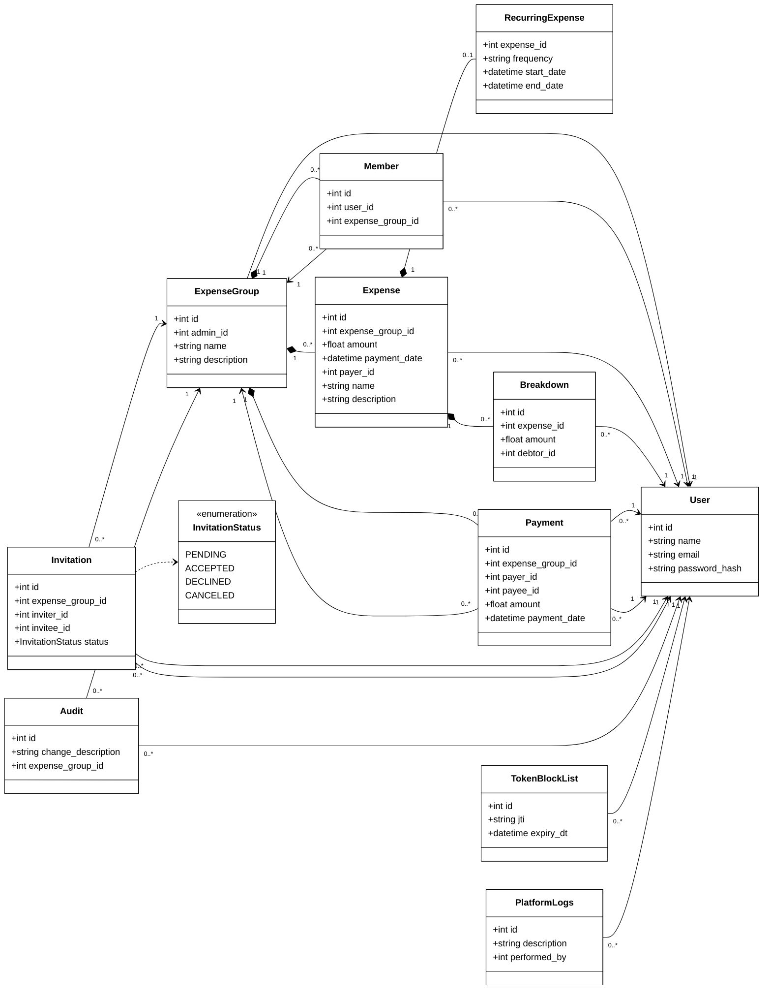

[](https://classroom.github.com/a/_63RRTUw)

# DivvyUp

## Project Overview
**DivvyUp** is a web-based shared expense management platform that enables users to track, split, and settle expenses within groups. Users can create expense groups, record shared costs, track payments between members, and automatically calculate balances. The application features secure authentication, receipt attachments, recurring expenses, and audit trails for transparency.

## Technology Stack

**Backend:**
- Python 3.12
- FastAPI 0.119.0
- SQLModel 0.0.27 (ORM built on SQLAlchemy)
- SQLAlchemy 2.0.44
- Pydantic 2.12.3 (data validation)
- Uvicorn (ASGI server)

**Authentication & Security:**
- python-jose 3.5.0 (JWT token handling)
- passlib 1.7.4 (password hashing)
- bcrypt 4.3.0
- cryptography 46.0.2
- SSL/TLS encryption (HTTPS)

**Database:**
- MySQL (latest via Docker)
- PyMySQL 1.1.2 (MySQL connector)

**Frontend:**
- HTML5
- Bootstrap 5.3.2
- Jinja2 3.1.6 (server-side templating)
- Vanilla JavaScript

**Configuration & Deployment:**
- python-dotenv 1.1.1 (environment variable management)
- Docker & Docker Compose
- Docker volumes for persistent storage


## Setup & Deployment

### Prerequisites
- Docker and Docker Compose installed
- OpenSSL (for SSL certificate generation)

### Environment Variables
Create a `.env` file in the root directory with:
```env
SECRET_KEY=your_secret_key_here
```

**Note:** Other environment variables (DB credentials, host) are configured in `docker-compose.yml`

### SSL Certificates
Generate SSL certificates for HTTPS:
```bash
sudo openssl req -x509 -newkey rsa:4096 -nodes -out cert.pem -keyout key.pem -days 365
```

### Running the Application

**1. Build and start containers:**
```bash
docker-compose up --build
```

**2. Access the application:**
- Navigate to: `https://localhost:443`
- Accept the self-signed certificate warning in your browser

**3. Stop the application:**
```bash
docker-compose down
```

### Database Initialization
- Database is automatically created on first run
- Initial setup scripts are located in `./init-scripts/` directory
- MySQL data persists in Docker volume `db-volume`
- Application data/images persist in Docker volume `app-volume`

### Docker Services
- **app**: FastAPI application running on port 443 (HTTPS)
- **db**: MySQL database running on port 3306
- Health checks ensure database is ready before app starts


## System Architecture & Design
### Architecture Diagram
```
┌─────────────────────────────────────────────────────────┐
│            Web Layer (main.py)                          |
│  - FastAPI App, Static Files, Jinja2 Templates          │
│  - HTML Pages, Bootstrap UI, JavaScript                 │
└────────────────────┬────────────────────────────────────┘
                     │
┌────────────────────▼────────────────────────────────────┐
│            Router Layer (app/routers/)                  |
│  - API Endpoints                                        |
|    (groups, expenses, payments, users, invitations)     |
│  - Request/Response Handling                            |
|  - Dependency Injection (UserDep, SessionDep)           |
└────────────────────┬────────────────────────────────────┘
                     │
┌────────────────────▼────────────────────────────────────┐
│           Service Layer (app/services.py)               |
│  - Business Logic & Validation                          │
│  - Validates entities, permissions, and business rules  │
│  - Enforces authorization and data integrity            │
└────────────────────┬────────────────────────────────────┘
                     │
┌────────────────────▼────────────────────────────────────┐
│        Data Access Layer (CRUD in routers/)             │
│  - Database Queries (SQLModel ORM)                      │
│  - Create, Read, Update, Delete functions               │
└────────────────────┬────────────────────────────────────┘
                     │
┌────────────────────▼────────────────────────────────────┐
│         Database (MySQL/SQLite)                         |
│  - Persistent Data Storage                              |
└─────────────────────────────────────────────────────────┘

Cross-Cutting Concerns (Used Across All Layers):
┌────────────────────────────────────────────────────────┐
│  Authentication & Security                             │
│  • app/auth.py - JWT token management, authentication  │
│  • app/security.py - Password hashing                  │
├────────────────────────────────────────────────────────┤
│  Data Models & Validation                              │
│  • app/models.py - SQLModel database models            │
│  • app/schemas.py - Pydantic validation schemas        │
├────────────────────────────────────────────────────────┤
│  Configuration & Database Management                   │
│  • app/database.py - DB connection, session mgmt       │
│  • .env - Environment variables                        │
└────────────────────────────────────────────────────────┘
```

### CLass Diagram



### Sequence Diagram: Add Member Workflow

**Summary:** This workflow demonstrates how an admin user adds a new member to an expense group, involving token validation, multiple service layer validations, database operations, and audit logging.

```mermaid
  sequenceDiagram
    actor User as Admin User
    participant Browser
    participant GroupDetailsJS as group_details.js
    participant Router as group.py<br/>(Router Layer)
    participant Auth as auth.py<br/>(Token Validation)
    participant Service as services.py<br/>(Business Logic)
    participant CRUD as CRUD.py<br/>(Data Access)
    participant Database as MySQL Database

    Note over User,Database: Add Member to Group Workflow

    User->>Browser: Click "Add Member" button
    Browser->>User: Show Add Member Modal
    User->>Browser: Enter email & submit
    
    Browser->>GroupDetailsJS: Form submit event
    GroupDetailsJS->>GroupDetailsJS: preventDefault()<br/>Show loading spinner
    
    GroupDetailsJS->>Router: POST /api/groups/{group_id}/members<br/>{email: "user@email.com"}
    
    Note over Router,Auth: Token Validation Phase
    Router->>Auth: Depends(get_current_user)
    Auth->>Auth: get_token_from_cookie()
    Auth->>Auth: decode_token(token)
    
    alt Token Invalid/Expired/Blocked
        Auth-->>Router: HTTPException 401
        Router-->>GroupDetailsJS: 401 Unauthorized
        GroupDetailsJS-->>User: Alert: "Session expired"
    end
    
    Auth->>Database: get_user_by_email(email from token)
    Database-->>Auth: Admin User object
    Auth-->>Router: Return authenticated Admin User
    
    Note over Router,Service: Service Layer Validations
    
    Router->>Service: validate_expense_group(db, group_id)
    Service->>CRUD: get_expense_group(db, group_id)
    CRUD->>Database: SELECT * FROM expense_group<br/>WHERE id = group_id
    Database-->>CRUD: ExpenseGroup or None
    
    alt Group Not Found
        CRUD-->>Service: None
        Service-->>Router: HTTPException 404<br/>"Expense group not found"
        Router-->>GroupDetailsJS: 404 Not Found
        GroupDetailsJS-->>User: Alert: "Expense group not found"
    end
    
    CRUD-->>Service: ExpenseGroup object
    Service-->>Router: ExpenseGroup validated
    
    Router->>Service: validate_group_admin(db, admin_id, group_id)
    Service->>CRUD: get_expense_group(db, group_id)
    CRUD->>Database: SELECT * FROM expense_group<br/>WHERE id = group_id
    Database-->>CRUD: ExpenseGroup object
    CRUD-->>Service: ExpenseGroup object
    
    Service->>Service: Check if admin_id == group.admin_id
    
    alt User is NOT Admin
        Service-->>Router: HTTPException 403<br/>"Only group admins can add members"
        Router-->>GroupDetailsJS: 403 Forbidden
        GroupDetailsJS-->>User: Alert: "Only group admins can add members"
    end
    
    Service->>CRUD: get_member(db, admin_id, group_id)
    CRUD->>Database: SELECT * FROM member<br/>WHERE user_id = admin_id<br/>AND expense_group_id = group_id
    Database-->>CRUD: Admin Member object
    CRUD-->>Service: Admin Member object
    Service-->>Router: Admin Member validated
    
    Router->>Service: validate_user_by_email(db, email)
    Service->>CRUD: get_user_by_email(db, email)
    CRUD->>Database: SELECT * FROM user<br/>WHERE email = email
    Database-->>CRUD: User or None
    
    alt User Not Found
        CRUD-->>Service: None
        Service-->>Router: HTTPException 404<br/>"User with email not found"
        Router-->>GroupDetailsJS: 404 Not Found
        GroupDetailsJS-->>User: Alert: "User with email not found"
    end
    
    CRUD-->>Service: User object (user_to_add)
    Service-->>Router: User validated
    
    Note over Router,Database: Add Member Business Logic
    
    Router->>Service: add_member_to_group_service(db, user_to_add, group_id, admin_member)
    
    Service->>CRUD: get_member(db, user_to_add.id, group_id)
    CRUD->>Database: SELECT * FROM member<br/>WHERE user_id = user_to_add.id<br/>AND expense_group_id = group_id
    Database-->>CRUD: Existing Member or None
    
    alt Member Already Exists
        CRUD-->>Service: Existing Member object
        Service-->>Router: HTTPException 409<br/>"User is already a member"
        Router-->>GroupDetailsJS: 409 Conflict
        GroupDetailsJS-->>User: Alert: "User is already a member"
    end
    
    CRUD-->>Service: None (user not a member)
    
    Service->>CRUD: create_member(db, user_to_add, group_id, admin_id)
    
    CRUD->>CRUD: get_member(db, admin_id, group_id)
    Note over CRUD: Get admin's member.id for added_by field
   
    
    CRUD->>CRUD: Create Member object<br/>(user_id=user_to_add.id,<br/>added_by=admin_member.id)
    CRUD->>Database: db.add(member)
    CRUD->>Database: db.commit()
    
    alt Database Constraint Error
        Database-->>CRUD: IntegrityError (UNIQUE constraint)
        CRUD->>Database: db.rollback()
        CRUD-->>Service: HTTPException 409<br/>"User already a member (constraint)"
        Service-->>Router: HTTPException 409
        Router-->>GroupDetailsJS: 409 Conflict
        GroupDetailsJS-->>User: Alert: Database constraint error
    end
    
    Database-->>CRUD: Member inserted successfully
    CRUD->>Database: db.refresh(member)
    Database-->>CRUD: Member with all fields
    CRUD-->>Service: New Member object
    Service-->>Router: New Member object
    
    Note over Router,Database: Create Audit Trail
    
    Router->>CRUD: create_audit(db, audit_data, group_id, admin_user)
    CRUD->>CRUD: Create Audit object<br/>(change_description, group_id, created_by)
    CRUD->>Database: db.add(audit)
    CRUD->>Database: db.commit()
    CRUD->>Database: db.refresh(audit)
    Database-->>CRUD: Audit record created
    CRUD-->>Router: Audit object
    
    Router->>Router: Build MemberRead response
    Router-->>GroupDetailsJS: 201 Created<br/>MemberRead JSON
    
    GroupDetailsJS->>GroupDetailsJS: Hide loading spinner
    GroupDetailsJS->>Browser: alert("Member added successfully!")
    GroupDetailsJS->>Browser: window.location.reload()
    Browser->>Router: GET /groups/{group_id}
    Router-->>Browser: Updated group page with new member
    Browser-->>User: Display updated member list
```



**Architecture Highlights:**
- **Token Validation**: JWT verification for stateless authentication
- **Authorization**: Admin-only access control (HTTP 403 if not admin)
- **Service Layer Validations**: 
  - Group existence check (`validate_expense_group`)
  - Admin permission verification (`validate_group_admin`)
  - User lookup by email (`validate_user_by_email`)
- **Business Logic**: Duplicate member prevention with database constraint handling
- **Audit Trail**: Automatic logging of member additions
- **Error Handling**: Comprehensive error responses (401, 403, 404, 409)

### Design Principles Applied

**Separation of Concerns:**
- Each layer has a single, well-defined responsibility
- Frontend separated into templates (structure), CSS (presentation), JS (behavior)
- Backend layers communicate through well-defined interfaces
- Changes to one layer minimally impact others

**Abstraction:**
- Database complexity hidden behind CRUD functions
- Authentication logic encapsulated in `auth.py`
- Business rules centralized in service layer
- UI components abstracted into reusable partials and macros

**High Cohesion:**
- Related functionality grouped together (e.g., all group operations in `groups.py`)
- Frontend organized by page/component purpose
- Each module focused on a specific domain

**Low Coupling:**
 Layers communicate through interfaces, not implementations
- Dependency injection for database sessions and authentication
- Frontend components independent and reusable

**DRY (Don't Repeat Yourself):**
- Reusable Jinja2 macros and partials
- Shared validation schemas (Base → Create → Update → Read pattern)
- Common UI components (navbar, pagination, modals)


## Testing Strategy

This project maintains high code quality and reliability through a robust **Integration Testing** suite.

### Core Technologies

- **Framework:** `pytest`
- **Client:** `httpx` (via FastAPI `TestClient`)
- **Database:** `SQLite` (In-Memory)

### Architecture & Implementation Details

1.  **In-Memory Database Isolation:**

    - Tests run against a `sqlite:///:memory:` database. This ensures tests are extremely fast and never affect the production (MySQL) database.

2.  **Dependency Injection Overrides:**

    - We utilize FastAPI's `app.dependency_overrides` feature.
    - **Database:** The production `get_db` dependency is swapped out for a fixture that yields a session connected to the in-memory SQLite DB.
    - **Authentication:** The `get_current_user` dependency is overridden to bypass JWT verification, allowing us to simulate specific user contexts.

3.  **Data Persistence & Cleanup:**
    - **Fixtures:** We use `pytest` fixtures to seed data (Users, Groups, Expenses) before tests run.
    - **Teardown:** The database schema is created fresh for every test session and dropped immediately after, ensuring no data pollution between tests.

### Docker Integration

1.  **Dedicated Test Container:** A specific service (`tests`) runs alongside the application.
2.  **Startup dependency:** The main application container (`app`) has a strict dependency on the test container:
    ```yaml
    depends_on:
      tests:
        condition: service_completed_successfully
    ```
3.  **Safety Gate:** When running `docker compose up`, the system first builds the image and runs the test suite. If any test fails, the main application container will refuse to start.

### How to Run Tests

#### Option 1: Run via Docker (Recommended)

This method ensures the environment matches production exactly.

```bash
docker compose up --build
```

_If the tests pass, the app will start on port 443. If they fail, the app container will not start, and errors will be displayed in the logs._

#### Option 2: Run Locally

If you are developing locally, you can run tests directly:

1.  Install dependencies:
    ```bash
    pip install pytest httpx
    ```
2.  Run the suite:

    ```bash
    # Run all tests
    python -m pytest

    # Run with verbose output
    python -m pytest -v
    ```

#####


## Security Considerations

**Implemented Security Measures:**
- HTTPS/SSL encryption for all traffic (TLS certificates)
- Password hashing using bcrypt
- JWT-based authentication via python-jose
- Environment variable management for sensitive data (SECRET_KEY)
- SQL injection prevention via SQLModel/SQLAlchemy ORM
- Docker container isolation
- **Platform audit logging** (`PlatformLogs`) for authentication attempts and critical actions

**Security Risks Mitigated:**
- Man-in-the-middle attacks (SSL/TLS)
- Password breaches (bcrypt hashing with salts)
- SQL injection (parameterized queries via ORM)
- Credential exposure (environment variables, not hardcoded)
- **Unauthorized access attempts** (logged via PlatformLogs for monitoring and alerting)
- **Security incident investigation** (audit trail enables forensic analysis)

**Note on Database Credentials:**
- The database password in `docker-compose.yml` is hardcoded as per project requirements
- Store sensitive credentials in `.env` files (excluded from version control via `.gitignore`)
- Use Docker secrets or environment variables for all passwords

**Deployment Considerations:**
- Use proper CA-signed certificates in production (not self-signed)
- Rotate SECRET_KEY regularly
- Use strong database passwords
- Keep dependencies updated for security patches
- Consider adding rate limiting for API endpoints

## Code Quality & Maintainability

### Code Organization Principles

The application follows a **layered architecture** with clear separation of concerns, promoting maintainability, testability, and scalability.

---

#### **Backend Architecture**

#### 1. **Web Layer** (`main.py`)
- Entry point for the FastAPI application
- Defines route mounting and dependency injection
- Configures static files and Jinja2 templates
- Handles HTML page rendering
- Lifecycle management (database initialization on startup)
```python
# Router organization by resource
app.include_router(expense.router)
app.include_router(group.router)
app.include_router(invitation.router)
app.include_router(user.router)
app.include_router(payment.router)
```

#### 2. **Router Layer** (`app/routers/`)
- **Purpose**: API endpoint definitions organized by resource
- **Files**: `groups.py`, `payments.py`, `expense.py`, `user.py`, `invitation.py`
- **Responsibility**:
  - HTTP request/response handling
  - Request validation via Pydantic schemas
  - Authentication checks using dependencies
  - Delegates business logic to service layer
  - Delegates data access to CRUD functions

#### 3. **Service Layer** (`app/service.py`)
- **Purpose**: Business logic and validation
- **Responsibility**: 
  - Validates business rules before database operations
  - Ensures data integrity across multiple operations
  - Provides reusable validation functions (e.g., validate group membership, expense ownership)
```python
# Example: Business rule validation
```python
# Example: Validates group existence and user membership
validate_expense_group(db, group_id, error_detail)
validate_group_member(db, user_id, group_id, error_detail)
```

#### 4. **Data Access Layer** (`app/crud.py` CRUD functions)
- **Purpose**: Direct database operations (Create, Read, Update, Delete)
- **Responsibility**: 
  - All SQL queries and database transactions
  - Data retrieval and persistence
  - No business logic - pure data access


#### 5. **Authentication & Authorization** (`app/auth.py` & `app/security.py`)
**`app/security.py`:**
- **Purpose**: Password hashing utilities (separated to avoid circular imports)
- **Functions**:
  - `hash_password()`: Securely hash passwords using bcrypt
  - `verify_password()`: Verify plaintext password against hashed version
- **Implementation**: Uses passlib with bcrypt scheme and automatic deprecation handling

**`app/auth.py`:**
- **Purpose**: JWT token management and user session handling
- **Functions**:
  - `create_token()`: JWT token generation
  - `decode_token()`: Token validation and parsing
  - `authenticate_user()`: Credential verification (uses `verify_password()` from security.py)
  - `get_current_user()`: Extract authenticated user from request
  - `get_current_user_optional()`: Optional authentication for public pages
  - Token blocklist management for logout functionality


#### 6. **Database Configuration** (`app/database.py`)
- **Purpose**: Database connection and session management
- **Features**:
  - Environment-specific configuration (DEV/STG/PRD)
  - SQLite for development, MySQL for production
  - Dependency injection for database sessions via `SessionDep`
  - Automatic path resolution for database files

#### 7. **Data Models** (`app/models.py`)
- **Purpose**: SQLModel ORM definitions
- **Structure**: Database tables as Python classes with:
  - Type-annotated fields
  - Foreign key relationships
  - Automatic timestamp tracking (created_on, modified_on)
  - Audit fields (created_by, modified_by)
  - Bidirectional relationships using `Relationship()`
```python
# Example: Payment model with relationships
class Payment(SQLModel, table=True):
    payer: User = Relationship(back_populates="payments_made")
    payee: User = Relationship(back_populates="payments_received")
```

#### 8. **Data Validation** (`app/schemas.py`)
- **Purpose**: Pydantic models for request/response validation
- **Pattern**: Base → Create → Update schemas
  - `Base`: Common fields shared across operations
  - `Create`: Fields required for creating new records
  - `Update`: Optional fields for partial updates
  - `Read`: Fields returned to frontend (includes computed/related data)
- `model_config = ConfigDict(from_attributes=True)` enables ORM-to-Pydantic conversion
- Ensures type safety and automatic validation at API boundaries
- Applied consistently across all domain models (Users, Groups, Expenses, Payments, etc.)

#### **Frontend Architecture**

**Templates Structure** (`app/templates/`)

**`layout.html`:**
- Base template with common HTML structure
- Includes Bootstrap, navbar, and footer
- Other templates extend this for consistency

**`pages/`:** Full-page templates
- **Organization Strategy**: Mix of inline and external JavaScript based on complexity
  - **Inline JS**: Simple pages with minimal logic
  - **External JS**: Complex pages requiring maintainability (e.g., `groups.html`, `group_details.html`, `payments.html`, `invitations.html`)
- **Key Pages**:
  - Authentication: Login and registration pages
  - Groups: Listing, details, and management interfaces
  - Expenses: Forms and table views for expense tracking
  - Payments: Payment history and settlement interfaces
  - Invitations: Group invitation management

**`partials/`:** Reusable UI components
- `navbar.html`: Navigation bar with authentication state
- `pagination.html`: Reusable pagination controls
- Multiple modals for create/edit/delete operations across different resources
- Card components for consistent UI patterns
- **Purpose**: DRY principle - avoid template duplication

**`macros/`:** Jinja2 macros
- Reusable template functions for repeated HTML patterns
- Further reduces code duplication

**Static Assets** (`app/static/`)

**`css/`:** Custom stylesheets
- Minimal custom styles (primary styling via Bootstrap)

**`js/`:** JavaScript files
- `groups.js`: Group listing interactions
- `group_details.js`: Group detail page functionality
- Additional JS files for complex page interactions
- **Separation Criteria**: External files for pages with multiple functionalities or complex logic
- Improves maintainability and code organization

---


### Error Handling

**Backend Error Handling:**
- **Consistent HTTP Responses**: Appropriate status codes with descriptive messages
- **Validation Errors**: Caught at Pydantic schema level before reaching business logic
- **Database Errors**: 
  - Session management with context managers (`with Session(engine)`)
  - Graceful handling of constraint violations
  - Transaction rollback on failures
- **Authentication Errors**: 
  - JWT validation with proper exception handling
  - Token blocklist checking for logged-out users
  - Clear 401 Unauthorized responses

**Frontend Error Handling:**
- Form validation with user-friendly error messages
- Graceful handling of API failures
- Loading states and user feedback for async operations

---


### Extensibility Features

**Multi-Database Support:**
- Environment-based configuration (SQLite for dev, MySQL for prod)
- Easy switching between database systems without code changes
- Database URL construction abstracted in `database.py`

**Modular Router Design:**
- New features added as separate router modules
- Simply include new routers in `main.py`
- No modification to existing routers required

**Flexible Authentication:**
- Optional authentication support (`get_current_user_optional`) for public pages
- Token-based system allows extension to OAuth/SSO
- Blocklist mechanism supports advanced session management

**Component Reusability (Frontend):**
- Partials and macros easily composed into new pages
- Bootstrap components ensure consistent styling


**Audit Trail:**
- **User-Level Audit**: All domain models track `created_by`, `modified_by`, `created_on`, `modified_on`
  - Visible to group admins (e.g., "who added this expense?")
  - Supports accountability within expense groups
  
- **Platform-Level Audit** (`PlatformLogs` model):
  - Logs authentication attempts (successful and failed)
  - Tracks critical system actions for security monitoring
  - Backend-only access for administrators and security audits
  - Nullable `performed_by` field supports logging anonymous/failed actions
  
- Ready for compliance requirements
- Supports forensic analysis and security incident response

### Cross-Platform Considerations

**Frontend Compatibility:**
- Jinja2 templates render on server-side (works on any browser)
- Bootstrap ensures responsive design (desktop/tablet)
- JavaScript enhancements degrade gracefully

**Backend Portability:**
- Docker containerization ensures consistent deployment
- Database abstraction allows switching RDBMS systems
- Environment variables for configuration flexibility
- Platform-agnostic Python code

### Logging Strategy

**Current Implementation:**
- SQLAlchemy `echo=False` in production (configurable for debugging)
- FastAPI automatic logging of requests/responses
- JWT token validation logs authentication failures

**Future Enhancements:**
- Structured logging with log levels (INFO, WARNING, ERROR)
- Request ID tracking across layers
- Performance monitoring and slow query logging
- Frontend error tracking (e.g., Sentry integration)


## External Documentation

### API Documentation
- **FastAPI Interactive API Docs (Swagger UI)**: `https://localhost:443/docs`
- Interactive API documentation with try-it-out functionality
- Automatically generated from FastAPI route definitions
-Includes all endpoints, request/response schemas, and authentication requirements

### Framework & Library Documentation
- [FastAPI Official Documentation](https://fastapi.tiangolo.com/)
- [SQLModel Documentation](https://sqlmodel.tiangolo.com/)
- [Pydantic Documentation](https://docs.pydantic.dev/)
- [Jinja2 Template Documentation](https://jinja.palletsprojects.com/)
- [Docker Documentation](https://docs.docker.com/)
- [MySQL Documentation](https://dev.mysql.com/doc/)

### Security & Authentication
- [python-jose Documentation](https://python-jose.readthedocs.io/)
- [Passlib Documentation](https://passlib.readthedocs.io/)
- [JWT.io](https://jwt.io/) - JWT token information and debugging